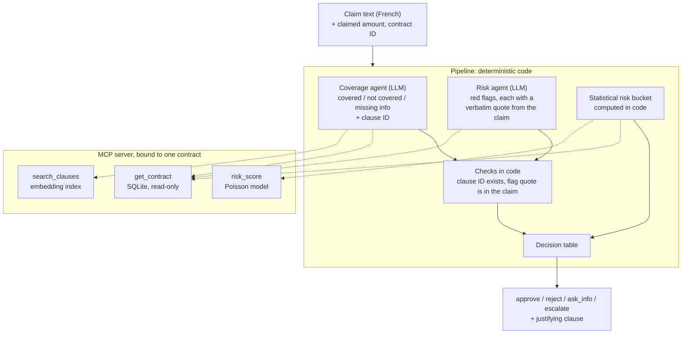

# Claims Triage Agent

A small multi-agent system that triages French motor insurance claims, and the
evaluation pipeline that measures it. The agent is deliberately simple. The
evaluation is the point of the project: every decision is scored per component,
traced end to end, and reproducible from a single command.

**Status:** work in progress. The agents and the code-level evaluation are built
and measured. LLM-judge calibration, red-teaming, CI and the production loop are
next (see [Roadmap](#roadmap)).

## At a glance

| | |
|---|---|
| **Task** | A claim in French + a claimed amount → `approve`, `reject`, `ask_info` or `escalate`, with the policy clause that justifies it |
| **Design** | Two LLM agents (coverage, risk) that never see each other's output; the final decision is a fixed table applied in code |
| **Data** | 678k real French motor contracts (freMTPL2), one public insurer policy PDF split into 38 clauses, 58 hand-built golden claims |
| **Model** | `gemini-3.5-flash-lite` for both agents; a gradient-boosted Poisson model for claim frequency |
| **Result so far** | 174/174 correct decisions on the golden set (58 cases × 3 runs), but the cited clause is wrong in 11 of 156 runs. See [Results](#results) |
| **Cost** | About $0.004 and 11 s per claim |

## How it works



Three choices shape the design:

- **The LLM never decides the outcome.** Agents answer narrow questions (is this
  covered, under which clause; is anything in the text suspicious). The decision
  itself is a table in code, so it can be unit-tested without a model.
- **The agents are independent.** The coverage agent cannot see risk flags, and
  the risk agent cannot see the coverage result. A suspicious claim cannot
  quietly become an uncovered one.
- **Numbers are computed, not generated.** The claimed amount is a structured
  input, and the risk bucket comes from a Poisson tail probability calculated in
  code from the model's predicted claim rate.

### Decision table

First matching rule wins.

| # | Condition | Decision |
|---|-----------|----------|
| 1 | Information is missing | `ask_info` |
| 2 | Not covered | `reject`, citing the exclusion clause |
| 3 | Covered, no amount provided | `ask_info` |
| 4 | Covered, amount ≤ deductible | `reject`, citing the deductible clause |
| 5 | Covered, and high statistical risk, or amount > €4,000, or at least one validated red flag | `escalate` to a human |
| 6 | Otherwise | `approve` |

Risk never causes a rejection. A rejection always rests on a policy clause.

## What is measured

Each claim produces one nested trace in Langfuse (pipeline → agents → tool
calls) and one scored record. Each evaluation run is logged to MLflow with the
git commit, prompt versions and a hash of the dataset, so two runs are only
compared when they are comparable.

| Component | Metric | Why it matters |
|-----------|--------|----------------|
| Decision | Match rate, confusion matrix, wrongful reject / wrongful approve rates | The two error types have very different costs for an insurer |
| Coverage agent | Coverage match, cited-clause correctness | A correct decision on the wrong clause is still a badly grounded decision |
| Retrieval | Expected clause retrieved; cited clause was actually retrieved | Separates "the agent reasoned badly" from "the agent never saw the clause" |
| Risk agent | Flag precision / recall per flag type, false positives on hard negatives, share of flags whose quote exists in the claim | Flags trigger escalation, so false positives cost human time |
| Stability | Same answer across 3 runs of the same case | A system that changes its mind is not usable, whatever its average score |
| Operations | Error rate, latency (mean, p95), tokens and cost per claim | |

All rates are reported with raw counts, never as a bare percentage.

## Results

Golden set v2: 58 cases × 3 runs = 174 records, commit `36b4ec9`.

| Metric | Result |
|--------|--------|
| Decision match | 174 / 174 |
| Wrongful rejects / wrongful approves | 0 / 120, 0 / 135 |
| Coverage match | 174 / 174 |
| Correct clause cited | 145 / 156 (93%) |
| Expected clause retrieved | 147 / 156 (94%) |
| Cited clause was among those retrieved | 158 / 158 |
| Red flags: precision / recall | 36 / 39 (92%), 36 / 36 |
| False positives on hard-negative cases | 0 / 15 |
| Flag quote found verbatim in the claim | 39 / 39 |
| Same decision across 3 runs | 58 / 58 cases |
| Same decision, clause and flags across 3 runs | 52 / 58 cases |
| Errors | 0 / 174 |
| Latency per claim | 11.3 s mean, 14.5 s p95 |
| Cost per claim | $0.0038 (10.1k input, 295 output tokens) |

How to read these numbers:

- **This is not a held-out score.** The golden set was used while building the
  agents. 30 separate "production" claims are held out and stay unopened until
  the production-loop phase.
- **The move from 167 to 174 is partly a label fix.** The first baseline scored
  167/174. Six of the seven misses came from two cases whose expected answer was
  arguable, and those cases were rewritten (see [Limits](#limits)).
- **The decision score hides grounding errors.** In 11 runs the system reached
  the right decision while citing a clause that does not support it. One case
  (`golden_04`) does this on every run. All three flag false positives are a
  single case (`golden_25`, `driver_mismatch`).

## Findings

Bugs and behaviours found by running the system against the live API and
checking the traces, not by reading the code.

- **Two decisions instead of one.** The agent loop dropped the model's
  conclusion after its tool calls, then asked for structured output from
  scratch. The second answer silently replaced the first whenever they differed.
  This first looked like model instability. Once the loop restated its own
  conclusion instead of deciding again, cross-run agreement on decisions went to
  100%.
- **Right decision, wrong clause.** Some runs rejected correctly while citing a
  clause whose text does not contain the exclusion being invoked. Decision
  accuracy alone would have reported these as successes.
- **A failure with two causes.** One wrong run on `golden_25` was a retrieval
  miss (the exclusion clause was not returned, so the claim was judged covered)
  combined with an unrelated flag false positive that only became visible
  because of the first error.
- **68 flat traces instead of one tree per claim.** Langfuse spans only nest
  reliably with an explicit parent. A first fix relying on ambient
  OpenTelemetry context did not survive the async boundaries. It was caught by
  looking at the Langfuse UI, and trace structure is now verified in code after
  every run.
- **An optional tool call behind a required number.** The risk agent called
  `risk_score` in only 14 of 31 runs. The pipeline now calls it itself, so the
  risk bucket cannot depend on what the model chooses to do.
- **Gemini API specifics.** A replayed function call must carry the model's
  `thought_signature` verbatim, and a request cannot end on a model turn.

## Limits

- **`amount_vs_damage` has no cost reference.** The flag relies on the model's
  own sense of what a repair should cost. Two original cases with plausible
  damage at inflated amounts were missed on all 6 runs. They were rewritten so
  the disproportion is obvious, and the originals are kept unscored in
  `evals/golden/borderline.json`. A real claim that ambiguous would still be
  missed without external pricing data.
- **Small, synthetic claim set.** 58 golden cases written by one person, in
  clean French. Contract data is real, but the coverage tier and deductible
  columns are synthetic.
- **One policy document, one model.** Nothing here shows how the results
  transfer to another insurer's wording or another LLM.
- **No LLM judge yet.** Explanation quality and faithfulness are not measured.

## Security rules

Enforced in code, not in prompts.

| Rule | How |
|------|-----|
| An agent cannot read another customer's contract | The contract ID is bound when the MCP server starts. It is not a tool argument |
| The database cannot be modified | SQLite opened read-only, parameterized queries only |
| A hallucinated clause cannot reach a decision | Every cited clause ID is checked against the policy index. Unknown IDs fail loudly |
| A red flag needs evidence | Its quote must be an exact substring of the claim text, or the flag is dropped and logged |
| Large amounts always reach a human | The threshold is applied in code after the agents return |
| Agents cannot loop forever | Step limit and timeout on every agent loop |

Claim text and tool results are treated as untrusted data and are never
interpolated into a system prompt.

## Roadmap

| # | Phase | Status |
|---|-------|--------|
| 0 | Setup and tooling | Done |
| 1 | Contract data and risk model (Poisson deviance 0.579 vs 0.628 for a predict-the-mean baseline, on held-out data) | Done |
| 2 | Policy index (expected clause at rank 1 for 15 of 15 test queries) | Done |
| 3 | MCP server with security tests | Done |
| 4 | Golden dataset and held-out production set | Done |
| 5 | Agents and pipeline, one nested trace per claim | Done |
| 6 | Quality pipeline: code-level metrics and MLflow logging done; LLM-judge calibration against human labels, prompt comparison and agent-independence test remaining | In progress |
| 5b | Each agent behind an A2A server, validated against the same metrics | Planned |
| 7 | Red-team suite and CI gate | Planned |
| 8 | Production loop: score held-out traffic, promote failures to the golden set | Planned |

## Run it

Requires Python 3.12+, [`uv`](https://docs.astral.sh/uv/), a Gemini API key and
a free Langfuse Cloud account.

```bash
uv sync
cp .env.example .env        # then fill in the keys

# Build the data, the risk model and the policy index (once)
uv run python data/download_data.py
uv run python data/enrich_data.py
uv run python data/build_sqlite.py
uv run python models/train_risk_model.py
uv run python policy/download_policy.py
uv run python policy/chunk_policy.py
uv run python policy/index_policy.py

# Tests: no LLM call, no API key needed
uv run pytest

# Evaluate: prints the score table and logs the run to MLflow
uv run python evals/run_eval.py --set smoke
uv run python evals/run_eval.py --set golden --runs 3    # about 1,000 LLM calls, roughly $0.70
```

## Repository layout

```
data/        download, enrich and load the contracts into SQLite
models/      risk model training, Poisson risk bucket
policy/      download, chunk and index the policy clauses
mcp_server/  the three tools exposed to the agents
agents/      hand-written agent loop, coverage and risk agents, the pipeline
evals/       golden cases, metrics, eval runner, MLflow logging, trace checks
redteam/     promptfoo setup (attack cases to come)
tests/       pytest suite, no LLM required
config.py    model names, thresholds, paths
```

## Stack

Python · Gemini API · MCP Python SDK · Langfuse · MLflow · scikit-learn ·
pytest · ruff. No agent framework: the tool-calling loop is about 120 lines of
plain Python, so every span in a trace can be explained.

All claims are synthetic. The repository contains no real personal data.
